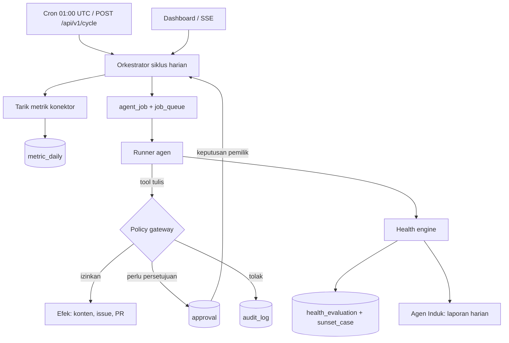

# Sistem Agen Induk untuk Portofolio SaaS

Satu platform "holding" yang menjalankan seluruh SaaS milik pemilik secara semi-otonom: tiap
SaaS Unit punya agen AI (Promosi, Review, Engineering, Support), satu **Agen Induk** menyusun
laporan dan mengevaluasi kesehatan portofolio, dan semua tindakan berisiko melewati
**policy gateway** serta antrean **persetujuan manusia**. Spesifikasi lengkap ada di
[`docs/SRS Sistem Agen Induk Portofolio SaaS.md`](./docs/SRS%20Sistem%20Agen%20Induk%20Portofolio%20SaaS.md),
status implementasi per butir di [`docs/CHECKLIST.md`](./docs/CHECKLIST.md).

## Mulai cepat (lokal, tanpa akun cloud)

Butuh Node.js 22+ (memakai `node:sqlite`). Tidak ada layanan eksternal yang dipanggil —
konektor dan model berjalan dalam mode mock deterministik.

```bash
npm install
cp .env.example .env        # opsional; nilai bawaan sudah cukup untuk lokal
npm run seed                # 3 SaaS Unit contoh + metrik 45 hari
npm start                   # http://127.0.0.1:8787
```

Lalu:

1. Buka <http://127.0.0.1:8787/> (URL lama `/dashboard` dialihkan ke sini).
2. Dapatkan token pengembangan: `curl -X POST localhost:8787/api/v1/login -H 'content-type: application/json' -d '{"role":"owner"}'`
   — atau tekan tombol **Token lokal: pemilik** di halaman masuk.
3. Tempel token di kolom **Token akses**, tekan **Masuk**.
4. Jalankan satu siklus harian (metrik → job agen → Health Score → laporan):
   ```bash
   TOKEN=... # dari langkah 2
   curl -X POST localhost:8787/api/v1/cycle -H "authorization: Bearer $TOKEN" \
        -H 'Idempotency-Key: cycle-lokal-001' -H 'content-type: application/json' -d '{}'
   ```
5. Muat ulang dashboard: skor, status, antrean persetujuan, dan laporan Agen Induk terisi.
   Perubahan dari siklus muncul otomatis lewat SSE (indikator **live** di sidebar).

Pengembangan dashboard (hot reload, API diproksikan ke server Node):

```bash
npm start        # terminal 1: API + dashboard hasil build di :8787
npm run dev:web  # terminal 2: Vite di :5173, /api & /healthz → 127.0.0.1:8787
```

Perintah lain:

| Perintah | Fungsi |
| --- | --- |
| `npm run typecheck` | TypeScript strict di semua paket, skrip, dan `apps/web` (`tsconfig.web.json`) |
| `npm test` | Test unit & integrasi (health, gateway, golden set, API, orkestrasi) |
| `npm run build` | Dashboard (`apps/web/dist`) + bundle Worker (`dist/api/index.js`) |
| `npm run smoke` | Uji end-to-end pada database sementara (migrasi → siklus → rute → sunset) |
| `npm run verify` | typecheck → test → build → smoke |
| `npm run migrate` | Terapkan migrasi SQLite lokal (`-- --sql` menulis ulang `migrations/0001_init.sql`) |
| `npm run agent:run -- --saas laporanku --fungsi review` | Jalankan satu agen; `--cycle` untuk siklus penuh |
| `npm run dashboard` | Bangun dashboard saja (Vite) |
| `npm run dev:web` | Vite dev server SPA dengan proxy API (hot reload) |

## Arsitektur



- `packages/shared` — skema Zod (metrik, konfigurasi, request), konstanta domain, Health engine murni.
- `packages/db` — antarmuka `Database` kompatibel D1, driver SQLite lokal, migrasi, repositori, audit ber-rantai-hash.
- `packages/agents` — definisi agen, tool + matriks izin, loop tool use, kebijakan anti prompt-injection, golden set.
- `packages/connectors` — konektor GitHub/Play/Instagram/Sentry/Billing/Analytics (mock + HTTP).
- `apps/api` — Hono: rute `/api/v1`, policy gateway, orkestrator, Health engine runtime, Durable Object guard.
- `apps/web` — dashboard SPA: React 19 + TanStack Router (routing & filter di URL) + TanStack Query
  (cache, invalidasi lewat SSE) + Tailwind 4 + Radix, dibangun Vite menjadi `apps/web/dist`.
- `scripts` — `node-server.ts`, `seed.ts`, `migrate.ts`, `build.ts`, `smoke.ts`, `agent-runner.ts`.

Detail dashboard: [`docs/dashboard.md`](./docs/dashboard.md).
Detail perilaku: [`docs/arsitektur.md`](./docs/arsitektur.md),
konfigurasi SaaS Unit: [`docs/konfigurasi-saas-unit.md`](./docs/konfigurasi-saas-unit.md),
kebijakan agen: [`docs/kebijakan-agen.md`](./docs/kebijakan-agen.md),
operasi & pemulihan: [`docs/runbook.md`](./docs/runbook.md).

## Keamanan ringkas

- Semua tool tulis lewat policy gateway; agen baca tidak punya tool merge/deploy/terbit.
- `audit_log` append-only (trigger SQL) dan ber-rantai hash; `GET /api/v1/audit/verify` memeriksa.
- Kill switch global/per SaaS bekerja seketika: gateway menolak dan job berjalan dibatalkan.
- Sunset tidak otonom: hanya pemilik + MFA; operator ditolak `403`.
- Teks luar (ulasan, issue, tiket) dibungkus sebagai data; instruksi di dalamnya tidak dieksekusi.

## Deploy (Cloudflare)

1. `npm run build` — hasilkan `dist/api/index.js` dan `apps/web/dist`.
2. Isi `database_id` di `apps/api/wrangler.production.jsonc` (juga staging bila perlu).
3. Jalankan migrasi: `npx wrangler d1 execute portfolio --remote --file=migrations/0001_init.sql`
   (dari direktori `apps/api`, dengan `assets.directory` relatif ke berkas konfigurasi).
4. `npx wrangler deploy --config wrangler.production.jsonc`.
5. Atur secret: `JWT_SECRET`, `ANTHROPIC_API_KEY` (bila memakai model nyata), kredensial konektor.
6. `.github/workflows/deploy.yml` menjalankan langkah di atas setelah `npm run verify` lulus.

Catatan: `main` pada `wrangler*.jsonc` merujuk `../../dist/api/index.js`, sehingga bundle dibangun
dari root repo. Blok `assets` memakai binding `ASSETS` (direktori `apps/web/dist`,
`not_found_handling: single-page-application`) agar dashboard disajikan sebagai static assets dan
rute klien tetap terbuka saat dimuat langsung; bucket R2 untuk arsip audit memakai binding terpisah `AUDIT_BUCKET`.
Binding `DailyRunWorkflow` (§11.4) sengaja dinonaktifkan di konfigurasi sampai kelas workflow-nya
diimplementasikan — binding ke kelas yang tidak ada akan menggagalkan deploy.
